# SOFTWARE ENGINEERING PROJECT REPORT
## NullWasted: Surplus Food Marketplace Platform with Agentic AI Assistant

**Course:** Software Engineering (RPL-2)  
**Academic Year:** 2026  
**Lecturer:** Prof. Dr. Ir. Riri Fitri Sari, M.M., MSc.  
**Institution:** Department of Electrical Engineering, Faculty of Engineering, Universitas Indonesia, Depok  

### Team Members (Group 16):
- **Michael Christian** – 2406348944
- **Qais Ismail** – 2406487090
- **Vincenzo Fabian Tisila** – 2406354215

---

## TABLE OF CONTENTS
- [CHAPTER III: SYSTEM ARCHITECTURE AND DESIGN](#chapter-iii-system-architecture-and-design)
  - [3.1 High-Level Architecture (The Helicopter View)](#31-high-level-architecture-the-helicopter-view)
    - [3.1.1 Architectural Philosophy and Multi-Tier Topology](#311-architectural-philosophy-and-multi-tier-topology)
    - [3.1.2 High-Level Architecture Diagram](#312-high-level-architecture-diagram)
    - [3.1.3 Subsystem Responsibilities and Data Flow](#313-subsystem-responsibilities-and-data-flow)
    - [3.1.4 Architectural Invariants and Trade-Off Rationale](#314-architectural-invariants-and-trade-off-rationale)
  - [3.2 Unified Modeling Language (UML) Diagrams](#32-unified-modeling-language-uml-diagrams)
    - [3.2.1 Use Case Diagrams (Functional View)](#321-use-case-diagrams-functional-view)
    - [3.2.2 Activity Diagrams (Process and Behavioral View)](#322-activity-diagrams-process-and-behavioral-view)
    - [3.2.3 Class Diagrams (Structural Domain Model)](#323-class-diagrams-structural-domain-model)
    - [3.2.4 Sequence Diagrams (Dynamic Interaction View)](#324-sequence-diagrams-dynamic-interaction-view)
    - [3.2.5 State Machine Diagrams (Lifecycle Statechart View)](#325-state-machine-diagrams-lifecycle-statechart-view)
    - [3.2.6 Deployment Diagram (Physical and Container Topology)](#326-deployment-diagram-physical-and-container-topology)
  - [3.3 Graphical User Interface (GUI) Design](#33-graphical-user-interface-gui-design)
    - [3.3.1 Design Guidelines and Design System Tokens](#331-design-guidelines-and-design-system-tokens)
    - [3.3.2 Core Screen Mockups and User Flow Specifications](#332-core-screen-mockups-and-user-flow-specifications)
      - [Screen 1: Welcome & Mission Onboarding](#screen-1-welcome--mission-onboarding)
      - [Screen 2: Dual-Role Authentication & Access Control](#screen-2-dual-role-authentication--access-control)
      - [Screen 3: Merchant Home & One-Touch Voice Listing](#screen-3-merchant-home--one-touch-voice-listing)
      - [Screen 4: 1-Tap Interactive Preview & Confirmation Card](#screen-4-1-tap-interactive-preview--confirmation-card)
      - [Screen 5: Merchant Cashier In-App Camera QR Scanner](#screen-5-merchant-cashier-in-app-camera-qr-scanner)
      - [Screen 6: Consumer Discovery Feed & Geolocation Proximity](#screen-6-consumer-discovery-feed--geolocation-proximity)
      - [Screen 7: Item Detail & Atomic Reservation Sheet](#screen-7-item-detail--atomic-reservation-sheet)
      - [Screen 8: Digital Pickup Pass with Unique QR Code](#screen-8-digital-pickup-pass-with-unique-qr-code)

---

## CHAPTER III: SYSTEM ARCHITECTURE AND DESIGN

Building upon the requirements baseline established in Chapter I and the Software Project Management Plan (SPMP) detailed in Chapter II, Chapter III formulates the architectural blueprints and interface specifications for **NullWasted**.

The architecture adheres to the international engineering standards ISO/IEC/IEEE 12207:2017 (*Software life-cycle processes*), the Object Management Group UML 2.5.1 specification, and the design principles outlined by Eric J. Braude & Michael E. Bernstein (2010).

---

### 3.1 High-Level Architecture (The Helicopter View)

#### 3.1.1 Architectural Philosophy and Multi-Tier Topology
NullWasted is architected as an edge-oriented, cloud-native marketplace supported by a resilient agentic intelligence tier. Traditional surplus food platforms impose excessive administrative friction on retail store personnel, forcing tired workers during closing hours to manually type product names, navigate categories, upload high-resolution images, and set discounts. 

To eliminate this operational friction, NullWasted adopts a 4-Tier distributed architecture where AI acts as an autonomous intermediary between unstructured human voice input and structured relational persistence:

1. **Client & Presentation Tier (Edge Devices):**
   * Responsive Progressive Web Application (PWA) built with React, Vite, and TypeScript.
   * Utilizes native browser Web Audio API for client-side PCM audio capture, HTML5 Geolocation API for store discovery, and HTML5 Canvas/MediaStream for cashier QR barcode scanning.
   * Runs natively on mobile browsers without requiring heavy app store downloads.

2. **Ingress, Network Security & Gateway Tier:**
   * Cloudflare Tunnel (`cloudflared`) providing end-to-end encrypted TLS ingress without opening public firewall ports.
   * Handles CORS enforcement, edge DDoS mitigation, and SSL/TLS termination.

3. **Application & Agentic Intelligence Tier (Compute Nodes):**
   * **Core REST API Service:** Asynchronous Python FastAPI framework implementing strict Pydantic v2 schemas and SQLModel ORM.
   * **Agentic AI Orchestrator:** LangGraph StateGraph engine coordinating voice transcription, natural language extraction, food safety evaluation, and dynamic pricing.
   * **Dedicated AI Gateway (9Router):** Standalone reverse proxy container managing multi-provider LLM failover across Google Gemini Flash, Zhipu GLM-4-Flash, and Groq Cloud (Llama 3.3 & Whisper Large V3).

4. **Persistence, Vector Store & Caching Tier:**
   * **PostgreSQL 16 with pgvector:** Single source of truth for relational ACID data and semantic vector embeddings (BPOM safety regulations and catalog similarity).
   * **Redis 7 Alpine:** High-speed in-memory store for distributed reservation locks, closing-window countdown timers, and rate-limiting buckets.

---

#### 3.1.2 High-Level Architecture Diagram
The macro-level ("Helicopter View") topology illustrates the complete ecosystem and data boundaries between external human actors, edge client tiers, internal containerized microservices, and external LLM provider clusters:

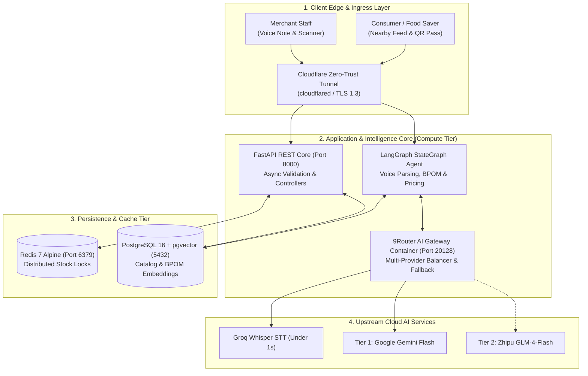
*Figure 3.1: NullWasted Helicopter View — Multi-Tier Cloud-Native Architecture.*

---

#### 3.1.3 Subsystem Responsibilities and Data Flow
The system processes information across five tightly decoupled functional pipelines:

* **Voice Ingestion & Audio Transcription:**
  The kitchen staff holds a recording button on their smartphone. The client's Web Audio API encodes the raw audio buffer as a compressed `audio/webm` blob and posts it through the Cloudflare Tunnel to `/api/v1/listings/voice`. FastAPI forwards the audio buffer to 9Router, which dispatches it directly to Groq Whisper Large V3. An Indonesian speech transcript is returned within 800 milliseconds.

* **Agentic Extraction & Schema Normalization:**
  The raw text transcript enters the LangGraph StateGraph. An extraction prompt enforces strict JSON output adhering to a Pydantic schema containing: item name, estimated portion count, category, original retail price, and preparation timestamp.

* **Deterministic Food Safety Guardrail:**
  The extracted food item is converted into a text embedding and matched against the official BPOM food safety knowledge base stored in PostgreSQL `pgvector`. A cosine similarity check determines perishable risk thresholds. If a dish contains fresh coconut milk (*santan*) or unpasteurized dairy held at room temperature exceeding 4 hours, the pipeline automatically flags the listing as hazardous and halts publication.

* **Dynamic Pricing with Fixed Publication Lock:**
  Safe items proceed to the Dynamic Pricing engine. The algorithm calculates an initial recommended discount between 50% and 70% based on the ratio of surplus quantity to remaining minutes before store closure. Once the merchant reviews and confirms the listing via the 1-Tap Preview Card, the discounted price is locked permanently to eliminate *strategic waiting* by consumers.

* **Atomic Stock Reservation and QR Handover:**
  When a consumer selects an item, a Redis distributed lock (`SET item_lock NX PX 900000`) reserves the stock unit for a 15-minute checkout window. Upon confirmation, a cryptographically signed digital QR pass is generated. At pickup, the store cashier scans the pass using the merchant camera module, verifying the token offline or online and mutating the database state to `COMPLETED`.

---

#### 3.1.4 Architectural Invariants and Trade-Off Rationale
* **Zero Operational Cloud Cost:** All databases, queues, and gateways run within localized, lightweight Docker containers consuming under 400 MB of system RAM. Cloud-hosted LLM endpoints are selected strictly from resilient, permanently free tiers (Gemini Flash, Zhipu GLM-4, Groq).
* **Zero PII Exposure to External AI Models:** Audio recordings and user personal data never touch third-party AI APIs. Only sanitized food descriptions and anonymized time parameters are passed to external LLM providers.
* **Strict Price Locking:** While prices are dynamically generated during listing formulation, they are strictly immutable post-publication, preserving merchant margin integrity and preventing opportunistic late-night bargaining.

---

### 3.2 Unified Modeling Language (UML) Diagrams

NullWasted models its functional boundaries, dynamic behavior, domain relationships, runtime interaction, lifecycle transitions, and physical infrastructure using the OMG UML 2.5.1 standard.

---

#### 3.2.1 Use Case Diagrams (Functional View)
The functional scope and boundary interactions of NullWasted are modeled across three modular Use Case sub-diagrams addressing specific user workflows:

##### A. Merchant Voice Ingestion and AI Guardrail Pipeline
Captures the interactions between store personnel and the agentic AI core during continuous speech recording, speech-to-text transcription, attribute extraction, and automated BPOM safety policy checking:

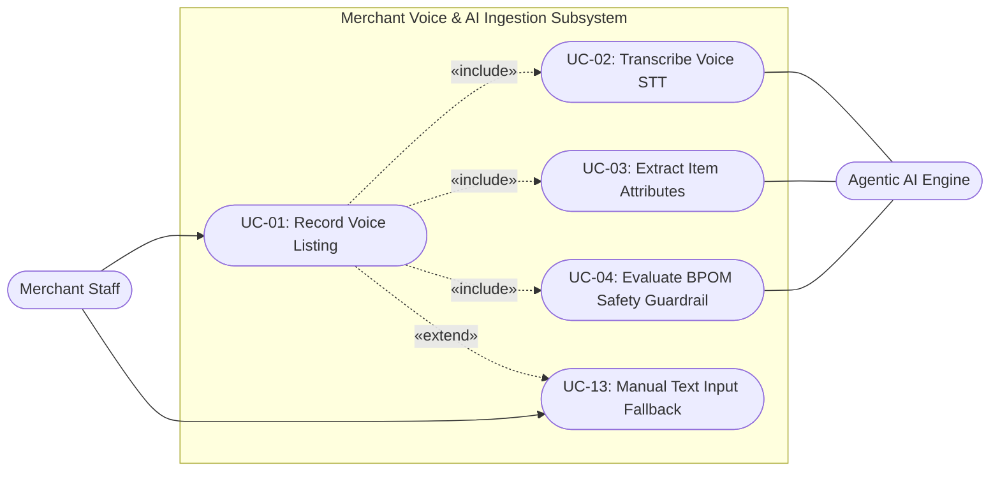
*Figure 3.2.a: Use Case Diagram — Merchant Voice Ingestion & AI Guardrail Pipeline.*

##### B. Merchant Dynamic Pricing and Store Catalog Management
Models dynamic closing-window discount calculation, the 1-Tap interactive preview card, algorithmic Mystery Bag bundling, and store catalog CRUD operations:

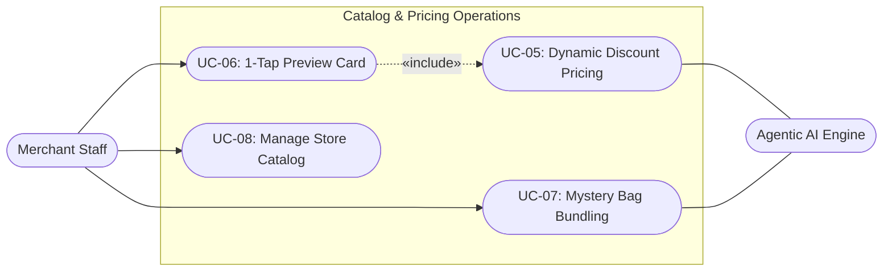
*Figure 3.2.b: Use Case Diagram — Merchant Pricing Formulation & Catalog Management.*

##### C. Consumer Discovery, Atomic Reservation and In-Store Handover
Illustrates geolocation feed discovery, distributed stock locking, signed Digital QR Pass generation, and physical cashier validation:

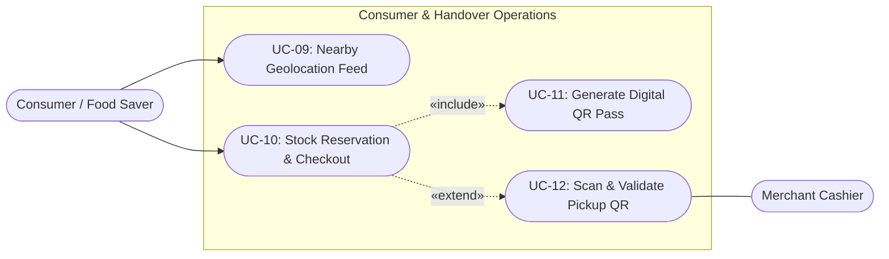
*Figure 3.2.c: Use Case Diagram — Consumer Discovery, Reservation & Handover.*

##### Key Use Case Specifications:
* **UC-01 (Record Voice Listing):**
  * *Actor:* Merchant Staff.
  * *Precondition:* Merchant is authenticated and closing window is active.
  * *Trigger:* Staff presses and holds the microphone button.
  * *Main Flow:* System records audio stream, pipes data to Whisper STT, extracts fields, checks BPOM rules, computes discount, and renders the 1-Tap Preview Card.
* **UC-04 (Evaluate BPOM Safety Guardrail):**
  * *Actor:* AI Agentic Engine (Automated System).
  * *Precondition:* Item attributes extracted from audio transcript.
  * *Main Flow:* Vector embedding generated and compared against BPOM perishable limits. If dish exceeds 4-hour room temperature threshold for dairy or coconut milk, auto-reject with specific alert.
* **UC-10 (Reserve Stock & Checkout):**
  * *Actor:* Consumer.
  * *Precondition:* Consumer selects an available listing within active pickup window.
  * *Main Flow:* System acquires Redis lock on item ID, decrements available inventory atomically, initiates a 15-minute countdown reservation, and issues a signed Digital QR Pass.
* **UC-12 (Scan & Validate Pickup QR):**
  * *Actor:* Merchant Staff / Cashier.
  * *Precondition:* Consumer presents Digital QR Pass at physical storefront.
  * *Main Flow:* Cashier scans QR via in-app camera; system verifies signature, validates matching order ID, releases reservation to `COMPLETED`, and invalidates the QR code.

---

#### 3.2.2 Activity Diagrams (Process and Behavioral View)
The operational process workflows and control logic of NullWasted are modeled through four core activity diagrams combining decision guardrails and sequential execution pipelines:

##### A. Voice Ingestion and Speech-to-Text Transcription Pipeline
Illustrates the edge-to-cloud audio capture flow from client-side Web Audio PCM streaming to Groq Whisper transcription, audio clarity validation, and LangGraph structured attribute extraction:

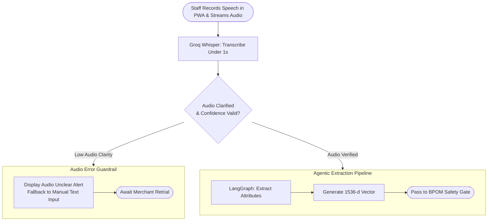
*Figure 3.3.a: Activity Diagram — Voice Ingestion & Audio Transcription Pipeline.*

##### B. BPOM Food Safety Evaluation and Dynamic Pricing Formulation
Models the automated vector similarity safety gate in PostgreSQL `pgvector`, regulatory policy violation branching, dynamic closing-window discount calculation, and immutable price locking:

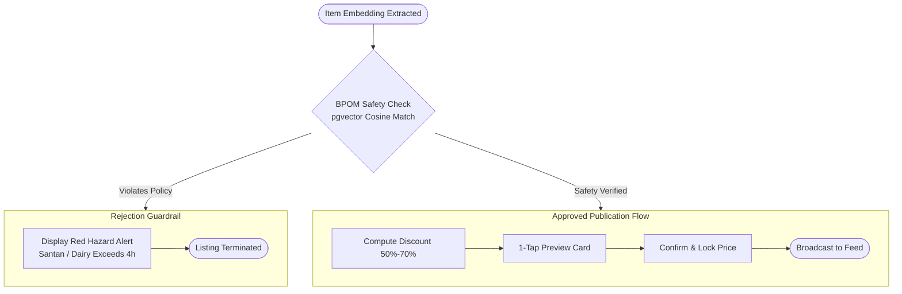
*Figure 3.3.b: Activity Diagram — BPOM Food Safety Evaluation & Dynamic Pricing Formulation.*

##### C. Consumer Discovery and Atomic Stock Reservation Locking
Details geolocation-filtered discovery, distributed Redis concurrency lock acquisition, checkout expiration timers, and cryptographically signed QR token generation:

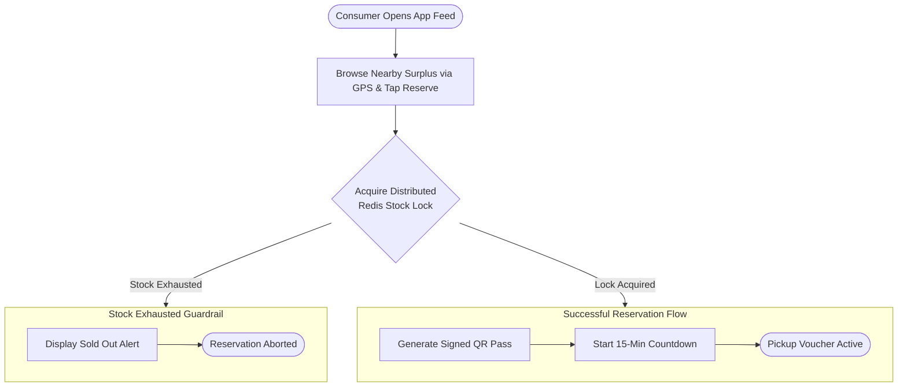
*Figure 3.3.c: Activity Diagram — Consumer Discovery & Atomic Stock Reservation Locking.*

##### D. Storefront Cashier Handover and In-App Scanner Verification
Covers the physical redemption protocol, HTML5 in-app camera barcode scanning, HMAC token validation, and transactional database state transitions:

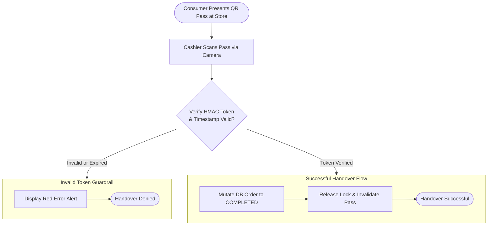
*Figure 3.3.d: Activity Diagram — In-Store Cashier Handover & In-App Scanner Verification.*

---

#### 3.2.3 Class Diagrams (Structural Domain Model)
The structural domain architecture of NullWasted is organized into three cohesive sub-domain class diagrams separating catalog management, AI safety policies, and transactional orders:

##### A. Store Profile and Catalog Inventory Sub-Domain
Defines the core catalog hierarchy, physical store coordinates, operational closing windows, category classifications, and dynamic mystery bag bundling:

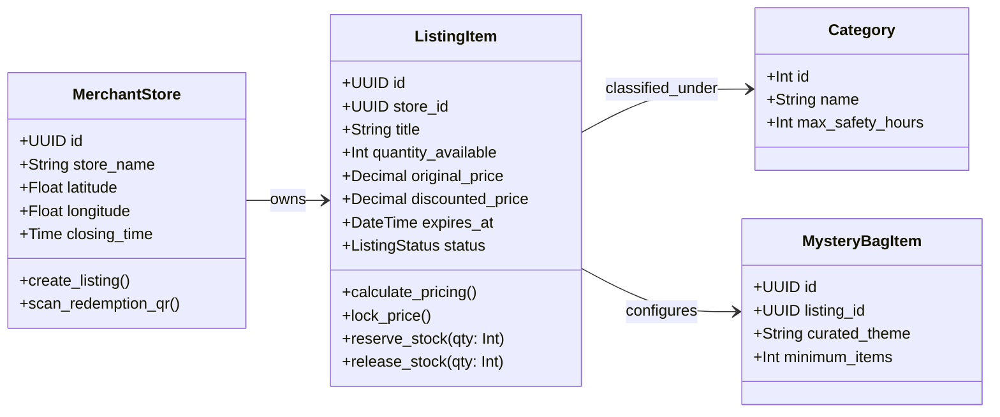
*Figure 3.4.a: Class Diagram — Store Profile and Catalog Inventory Sub-Domain.*

##### B. AI Voice Extraction and BPOM Safety Knowledge Sub-Domain
Models speech session buffers, Whisper transcription outputs, and cosine similarity checking against official BPOM regulatory food safety embeddings:

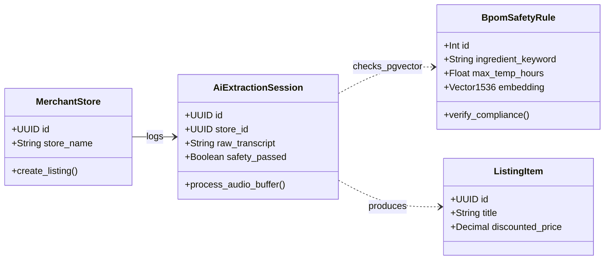
*Figure 3.4.b: Class Diagram — AI Voice Extraction and BPOM Safety Knowledge Sub-Domain.*

##### C. Transactional Reservation Orders and Digital QR Pass Sub-Domain
Encapsulates consumer stock reservations, 15-minute countdown locks, and HMAC-signed digital QR passes for in-store verification:

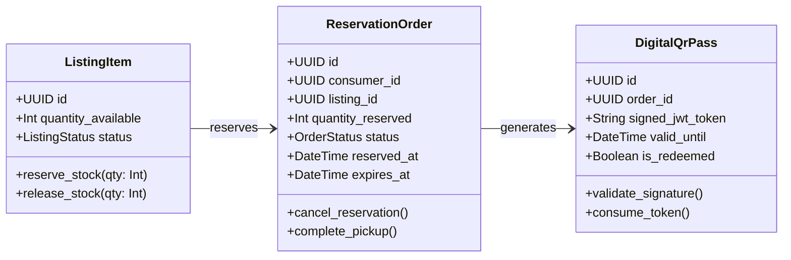
*Figure 3.4.c: Class Diagram — Transactional Reservation Orders and Digital QR Pass Sub-Domain.*

##### Domain Entity Dictionary and Multiplicity Specifications:
* **`MerchantStore`:** Manages merchant profile, physical location coordinates for radius distance calculation, and closing window schedules. Multiplicity: Owns zero-to-many (`1 : 0..*`) `ListingItem` records and logs AI extraction sessions (`1 : 0..*`).
* **`ListingItem`:** Represents the active food surplus entity. Encapsulates atomic stock counters, immutable price locking attributes, and expiration timestamps. Multiplicity: Classified under one (`0..* : 1`) `Category`, optionally configures one (`1 : 0..1`) `MysteryBagItem`, and holds zero-to-many (`1 : 0..*`) `ReservationOrder` claims.
* **`BpomSafetyRule`:** Encapsulates regulatory constraints with 1536-dimensional vector embeddings, enabling cosine similarity matching against raw dish transcripts. Checked on demand by AI extraction sessions.
* **`ReservationOrder`:** Tracks atomic consumer claims with strict 15-minute time-to-live (TTL) counters to prevent inventory hoarding. Multiplicity: Each order generates exactly one (`1 : 1`) `DigitalQrPass`.
* **`DigitalQrPass`:** Contains a cryptographically signed HMAC-SHA256 token encoding the order ID, store ID, and expiration timestamp. Redeemed once upon handover completion.

---

#### 3.2.4 Sequence Diagrams (Dynamic Interaction View)
The dynamic runtime interaction and message exchanges of the system are modeled across two sequential execution phases:

##### A. Voice Ingestion, STT Transcription and Entity Extraction Phase
Illustrates how raw continuous speech is ingested via browser Web Audio API, routed through the 9Router gateway, transcribed by Groq Whisper, and parsed into validated JSON.

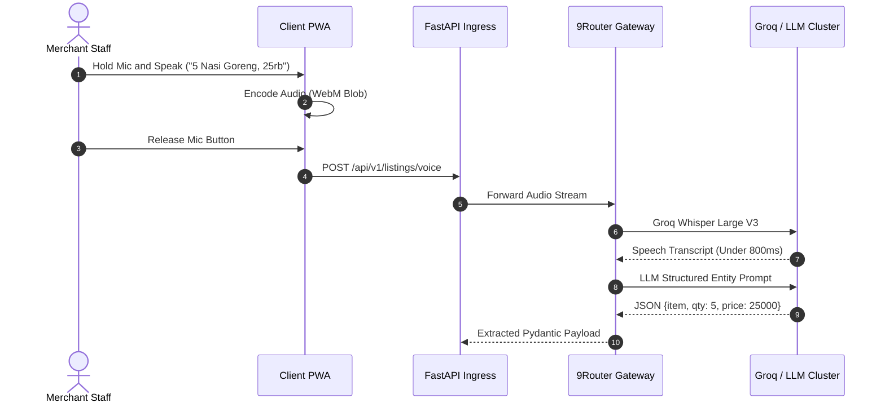
*Figure 3.5.a: Sequence Diagram — Voice Ingestion, STT Transcription and Entity Extraction.*

##### B. BPOM Safety Guardrail Verification and Publication Phase
Illustrates the semantic vector similarity evaluation in PostgreSQL pgvector, dynamic closing-window pricing calculation, 1-Tap confirmation review, and immutable publication.

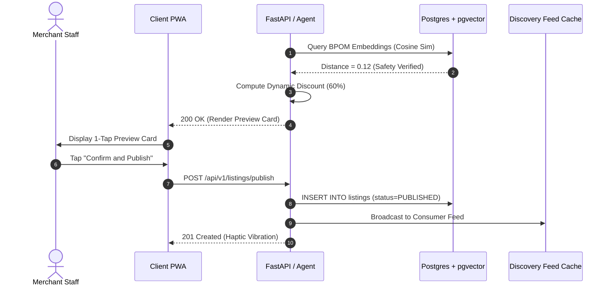
*Figure 3.5.b: Sequence Diagram — BPOM Safety Guardrail Verification and Publication Phase.*

---

#### 3.2.5 State Machine Diagrams (Lifecycle Statechart View)
The operational lifecycles and state transitions of NullWasted are modeled across two state machine diagrams utilizing composite sub-states and deterministic event triggers:

##### A. Surplus Food Listing & AI Safety Lifecycle
Tracks the discrete states of a food listing from voice recording, audio transcription, agentic extraction, and deterministic BPOM safety evaluation to immutable price locking:

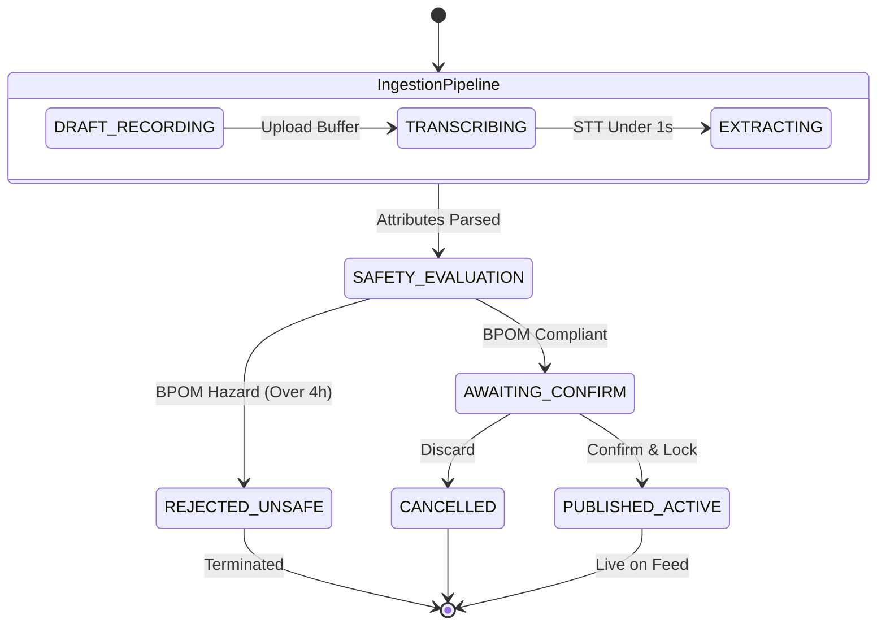
*Figure 3.6.a: State Machine Diagram — Surplus Food Listing & AI Safety Lifecycle.*

##### B. Consumer Reservation & Handover Lifecycle
Tracks the transactional state transitions of consumer stock reservations, Redis countdown locks, and in-person cashier verification:

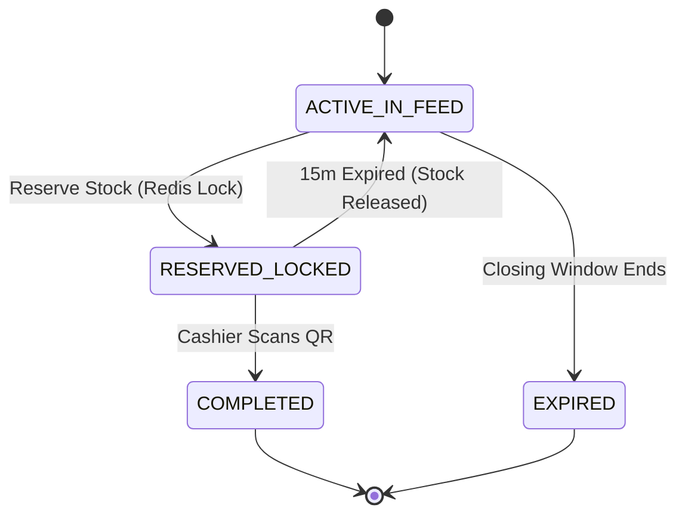
*Figure 3.6.b: State Machine Diagram — Consumer Reservation & Handover Lifecycle.*

---

#### 3.2.6 Deployment Diagram (Physical and Container Topology)
The Deployment Diagram models the physical runtime topology, computing nodes (`«device»`), container execution environments (`«execution environment»`), deployed software artifacts (`«artifact»`), network port bindings, and communication protocol paths according to the OMG UML 2.5.1 standard. It reflects how the logical components from the Helicopter View are physically instantiated and executed in localized Docker containers and edge devices:

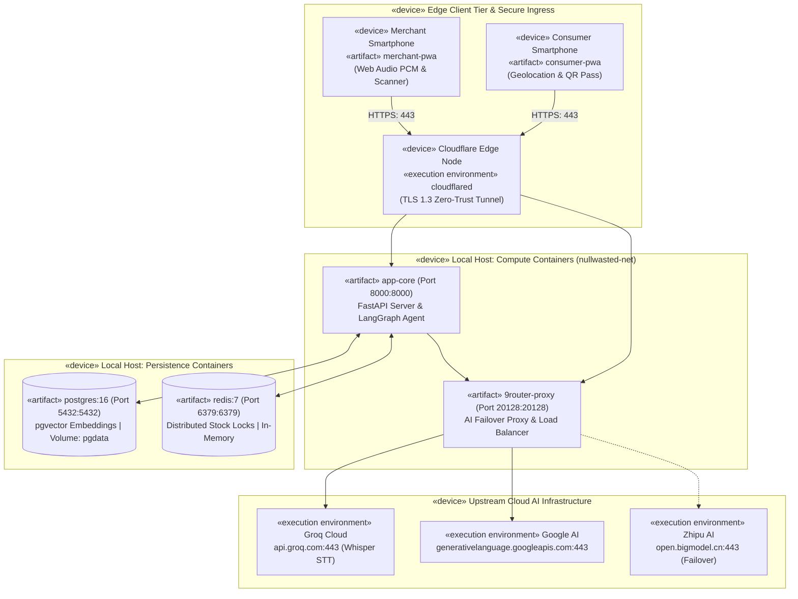
*Figure 3.7: Deployment Diagram — OMG UML 2.5.1 Physical Nodes, Container Artifacts and Network Topology.*

---

### 3.3 Graphical User Interface (GUI) Design

#### 3.3.1 Design Guidelines and Design System Tokens
The user interface of NullWasted is designed specifically for high-stress, rapid closing-hour environments in commercial kitchens, balanced with an engaging, trustworthy discovery experience for consumers.

##### Core Design Principles:
* **The 1-Hand Thumb Zone:** All critical interactive controls (Microphone hold button, 1-Tap confirmation buttons, and QR scan toggles) are situated within the bottom 40% of the mobile viewport, allowing single-handed operation while carrying food items.
* **High-Contrast Sunlight & Kitchen Visibility:** Dark slate backgrounds with vivid neon accents ensure interface legibility under harsh kitchen fluorescent lighting as well as outdoor sunlight during pickup walks.
* **Micro-Haptic Confirmation:** Native mobile vibrations accompany key interactions (voice recording start, voice recording lock, safety pass, and cashier scan redemption) to confirm operations without requiring continuous visual attention.

##### Color Palette Design Tokens:
* **Surplus Emerald (`#10B981`):** Primary brand accent. Represents freshness, sustainability, verified food safety, and successful redemptions.
* **Deep Obsidian (`#0F172A`):** Primary background base. Lowers eye strain, conserves OLED battery, and establishes a premium aesthetic.
* **Elevated Slate (`#1E293B`):** Surface card background. Used for modular content cards, popovers, and bottom sheets.
* **Urgent Amber (`#F59E0B`):** Warning and urgency indicator. Signals countdown timers, closing-window thresholds (<30 minutes), and dynamic discount badges.
* **Hazard Crimson (`#EF4444`):** Safety alert accent. Explicitly highlights BPOM food safety violations, expired vouchers, and invalid QR scans.
* **Pure Light (`#F8FAFC`):** Primary typography color, ensuring an accessible WCAG AAA contrast ratio exceeding 12:1 against the dark background.

##### Typography Hierarchy:
* **Headings & Display:** `Outfit` (Google Fonts) — Geometric sans-serif with friendly curves that deliver modern, welcoming branding.
* **Body & Numerical Values:** `Inter` (Google Fonts) — Highly legible grotesque sans-serif optimized for tabular numbers, countdown clocks, and pricing cards.

---

#### 3.3.2 Core Screen Mockups and User Flow Specifications

The visual wireframes and interface breakdowns specify the eight primary screens of the NullWasted application, organized into three logical tiers: Onboarding & Access Control, Merchant Operations, and Consumer Discovery & Handover.

---

##### Screen 1: Welcome & Mission Onboarding
* **Purpose:** Introduces the platform's zero-food-waste mission, displays live regional community impact metrics, and routes users to either consumer food discovery or merchant store onboarding.
* **Key Components:** Brand badge, value proposition banner, mission impact counters (kilograms of food saved and rupiah rescued), primary consumer entry button, and merchant onboarding link.

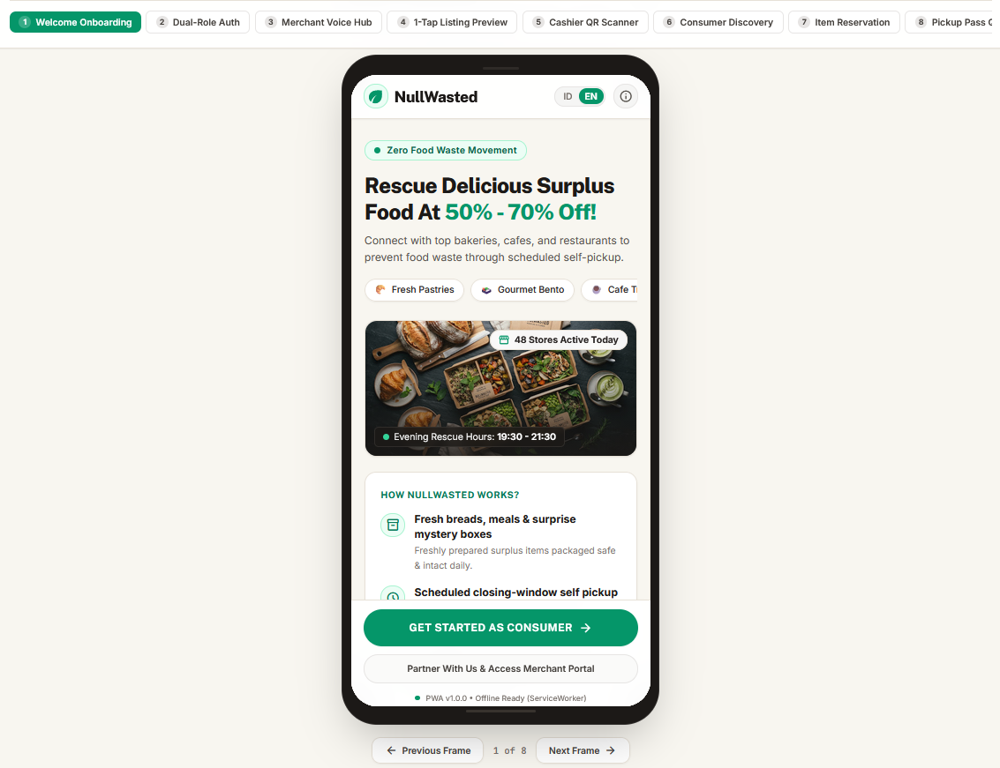

*Figure 3.8: Wireframe — Welcome and Mission Onboarding Screen.*

---

##### Screen 2: Dual-Role Authentication & Access Control
* **Purpose:** Implements Role-Based Access Control (RBAC) separating consumer savers from retail kitchen personnel, supporting frictionless OAuth / WhatsApp OTP for consumers and quick-entry terminal PINs for store staff.
* **Key Components:** Account type toggle (Consumer vs Store Partner), OAuth Google single sign-on, WhatsApp/SMS OTP input field, Store ID & 4-digit terminal PIN pad for kitchen staff, and food safety agreement terms.

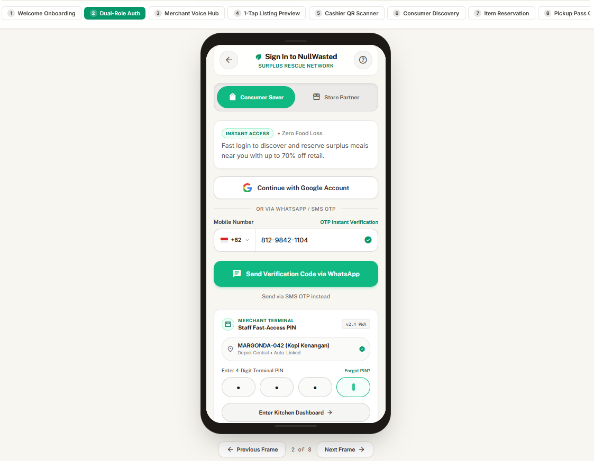

*Figure 3.9: Wireframe — Dual-Role Authentication and Access Control Screen.*

---

##### Screen 3: Merchant Home & One-Touch Voice Listing
* **Purpose:** Enables kitchen staff to initiate surplus listings using natural speech in under 5 seconds.
* **Key Components:** Store status badge, closing countdown indicator, active listing counter, and the central pulsating voice recording trigger.

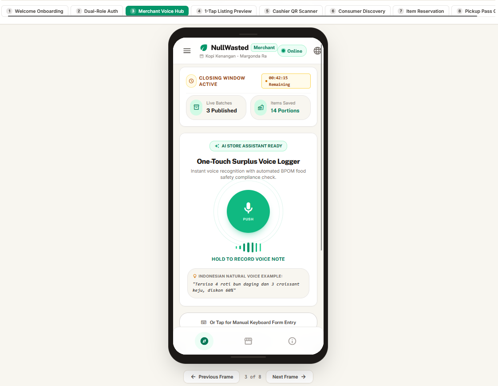

*Figure 3.10: Wireframe — Merchant Voice Assistant Home Screen.*

---

##### Screen 4: 1-Tap Interactive Preview & Confirmation Card
* **Purpose:** Displays structured AI extraction results, BPOM safety verification, and dynamic pricing recommendations for instant merchant confirmation.
* **Key Components:** Safety verification badge, portion stepper, original vs. discounted price breakdown, and the primary 1-Tap Publish button.

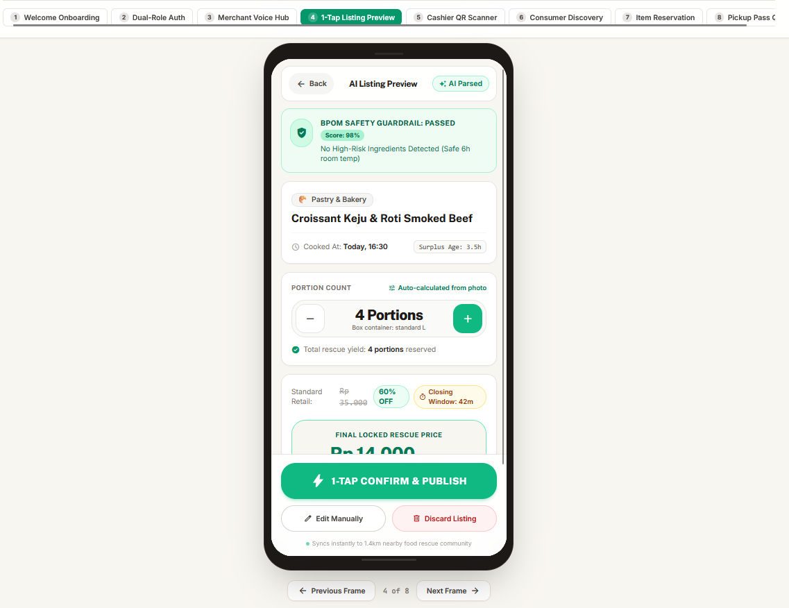
*Figure 3.11: Wireframe — 1-Tap Interactive Preview Card.*

---

##### Screen 5: Merchant Cashier In-App Camera QR Scanner
* **Purpose:** Enables store cashiers to scan consumer pickup passes using the device camera, validating orders instantly without dedicated POS hardware.
* **Key Components:** Camera viewfinder targeting reticle, flashlight toggle button, manual 6-character code fallback input, and audio/haptic confirmation toast.

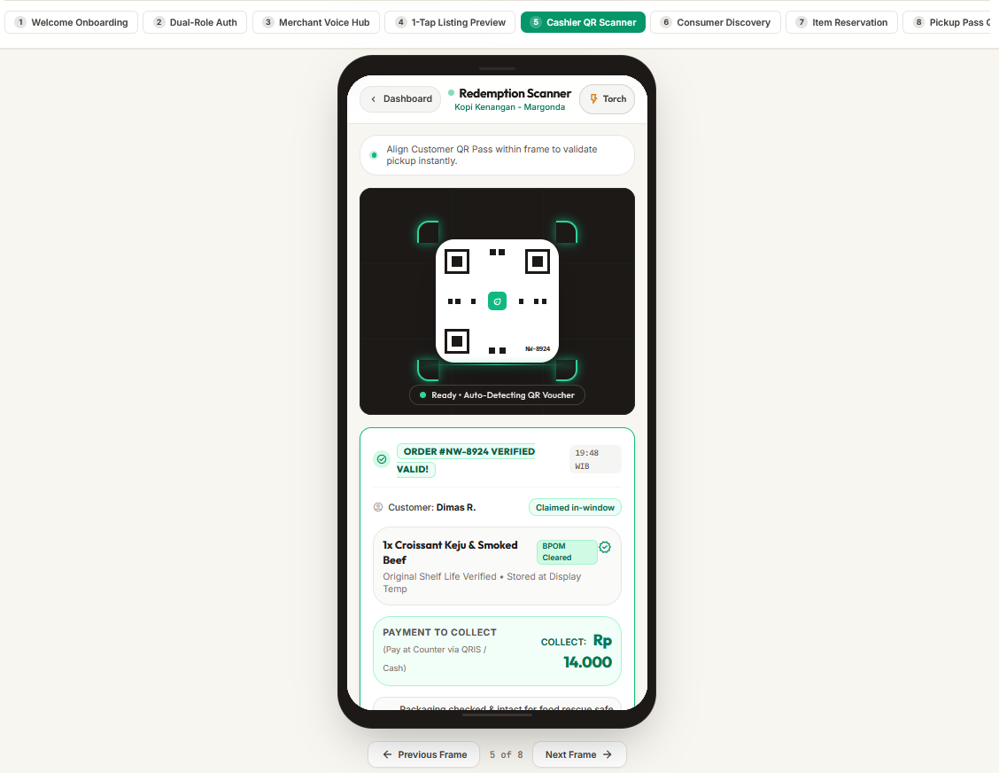

*Figure 3.12: Wireframe — Merchant Cashier In-App Camera QR Scanner.*

---

##### Screen 6: Consumer Discovery Feed & Geolocation Proximity
* **Purpose:** Presents available surplus food items in real-time, sorted by proximity to the consumer's current GPS location with live closing countdowns.
* **Key Components:** Geolocation selector, category filter pills, store distance badges, countdown timers, and discounted price tags.

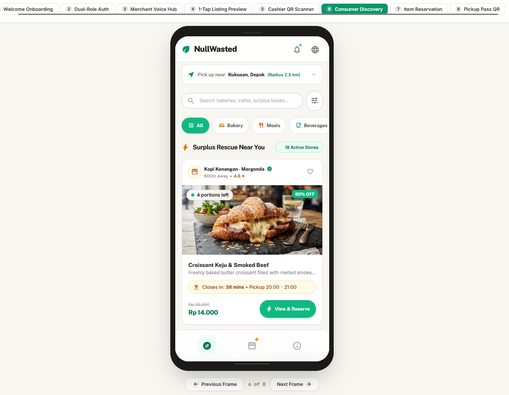

*Figure 3.13: Wireframe — Consumer Nearby Discovery Feed.*

---

##### Screen 7: Item Detail & Atomic Reservation Sheet
* **Purpose:** Provides comprehensive item descriptions, store pickup instructions, food safety guarantee notes, and the reservation checkout trigger.
* **Key Components:** Store address, pickup window schedule, portion availability meter, safety assurance card, and the instant reserve button.

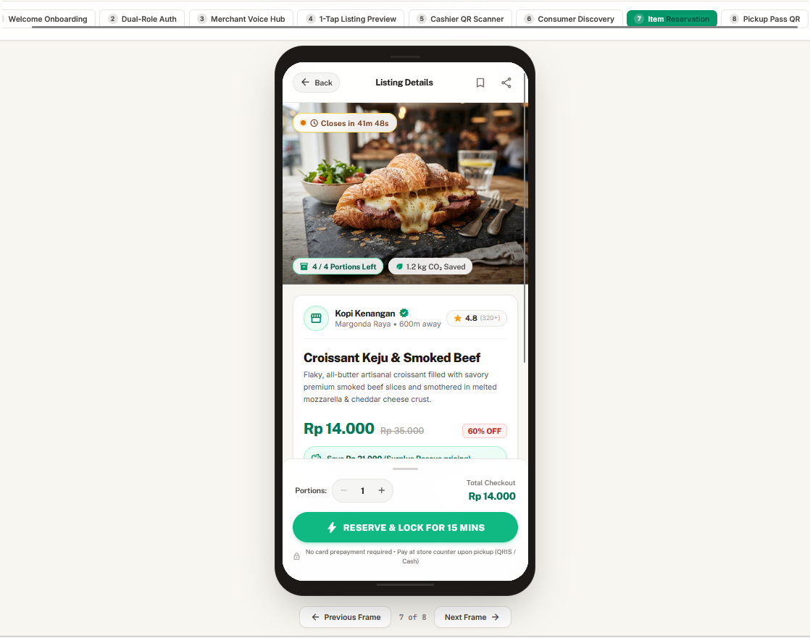

*Figure 3.14: Wireframe — Item Detail & Reservation Sheet.*

---

##### Screen 8: Digital Pickup Pass with Unique QR Code
* **Purpose:** Serves as the consumer's verified digital redemption voucher at the storefront counter.
* **Key Components:** Large high-contrast QR code, order ID, expiration countdown bar, store directions button, and verification status badge.

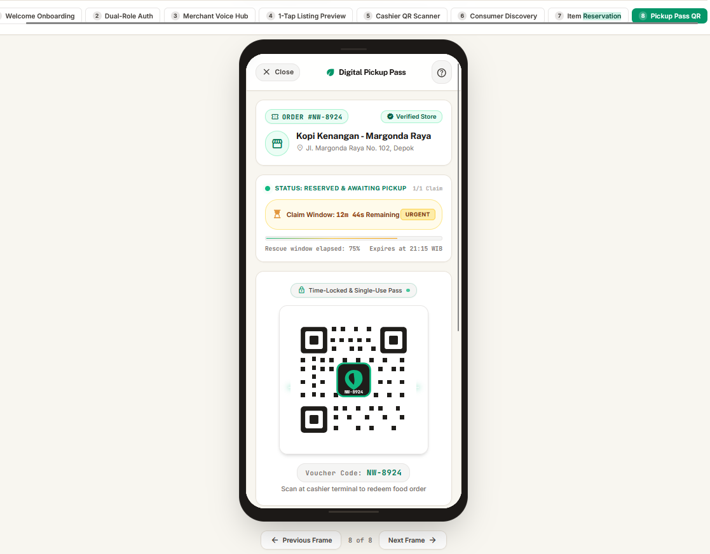

*Figure 3.15: Wireframe — Consumer Digital Pickup Pass with QR Code.*

---
